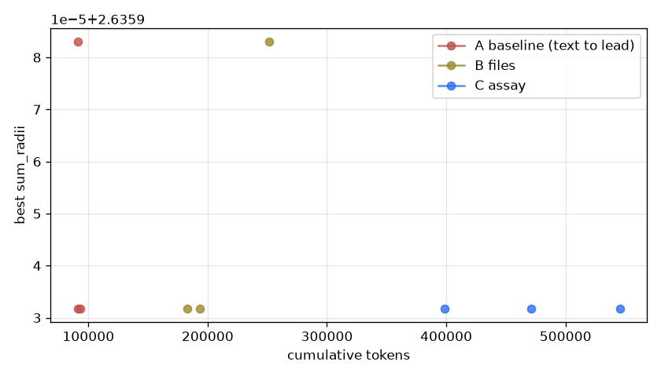

# benchbook benchmark report

| configuration | runs | evaluations | duplicate ratio | lost results | lead context max (tokens) | tokens total | API cost (USD) | final best | best per 1k tokens |
|---|---|---|---|---|---|---|---|---|---|
| A baseline (text to lead) | 3 | 60 ± 0 | 0.4056 ± 0.13 | 0 ± 0 | 2.94e+04 ± 4.9e+02 | 9.178e+04 ± 1e+03 | 0.5958 ± 0.03 | 2.636 ± 3e-05 | 0.02872 ± 0.00031 |
| B files | 3 | 60 ± 0 | 0.1444 ± 0.086 | 0 ± 0 | 3.401e+04 ± 1.5e+03 | 2.095e+05 ± 3.7e+04 | 0.8778 ± 0.036 | 2.636 ± 3e-05 | 0.01283 ± 0.0021 |
| C benchbook | 3 | 58.67 ± 0.58 | 0.3009 ± 0.037 | 0 ± 0 | 3.986e+04 ± 6.1e+03 | 4.717e+05 ± 7.3e+04 | 1.175 ± 0.12 | 2.636 ± 0 | 0.005681 ± 0.00089 |

Values are mean ± sample standard deviation over runs.

## Best-so-far vs cumulative tokens



0 of 9 runs reconcile assistant-message usage with the final total. Their steps use observed API usage checkpoints and the best evaluation completed by each checkpoint. Other runs contribute only their measured endpoint.

## Metric definitions

- duplicate ratio: evaluations whose (config, code) was evaluated at least twice / all evaluations
- lost results: evaluations that ran but appear neither in the lead's final report nor in a
  persistent record (ledger for C, result files for B). Real runs match individual receipt IDs,
  status and evaluation data.
- lead context max: largest prompt the lead saw (dry: simulated; real: max input+cache tokens of
  a top-level assistant turn)

## Conditions

```json
{
  "configs": "A,B,C",
  "runs": 3,
  "dry": false,
  "workers": 4,
  "rounds": 3,
  "evals": 5,
  "budget": 40000,
  "max_budget_usd": 5.0,
  "drop_rate": 0.15,
  "compact_at": 3000,
  "seed": 0,
  "model": "claude-sonnet-5-5",
  "max_turns": 80,
  "wall_clock": 60,
  "execute": true,
  "note": "C-3 re-run separately (bench/out/sonnet55-ae81ddc-run2-C3/C-1) after the first C-3 hit the account usage limit (HTTP 429)"
}
```
