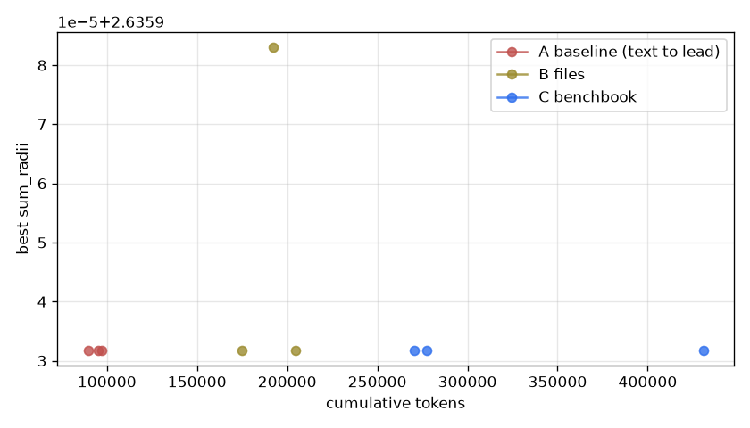

# benchbook benchmark report

| configuration | runs | evaluations | duplicate ratio | lost results | lead context max (tokens) | tokens total | API cost (USD) | final best | best per 1k tokens |
|---|---|---|---|---|---|---|---|---|---|
| A baseline (text to lead) | 3 | 60 ± 0 | 0.2944 ± 0.15 | 0 ± 0 | 3.05e+04 ± 1.3e+03 | 9.407e+04 ± 4e+03 | 0.6346 ± 0.015 | 2.636 ± 0 | 0.02806 ± 0.0012 |
| B files | 3 | 58.33 ± 2.9 | 0.1611 ± 0.054 | 0.3333 ± 0.58 | 3.558e+04 ± 3.1e+03 | 1.905e+05 ± 1.5e+04 | 0.9603 ± 0.04 | 2.636 ± 3e-05 | 0.01389 ± 0.0011 |
| C benchbook | 3 | 59.33 ± 1.2 | 0.2249 ± 0.1 | 0 ± 0 | 3.306e+04 ± 2e+03 | 3.261e+05 ± 9.1e+04 | 1.132 ± 0.029 | 2.636 ± 0 | 0.00846 ± 0.002 |

Values are mean ± sample standard deviation over runs.

## Best-so-far vs cumulative tokens



0 of 9 runs reconcile assistant-message usage with the final total. Their steps use observed API usage checkpoints and the best evaluation completed by each checkpoint. Other runs contribute only their measured endpoint.

## Metric definitions

- duplicate ratio: evaluations whose (config, code) was evaluated at least twice / all evaluations
- lost results: evaluations that ran but appear neither in the lead's final report nor in a
  persistent record (ledger for C, result files for B). Real runs match individual receipt IDs,
  status and evaluation data.
- lead context max: largest prompt the lead saw (dry: simulated; real: max input+cache tokens of
  a top-level assistant turn)

## Conditions

```json
{
  "configs": "A,B,C",
  "runs": 3,
  "dry": false,
  "workers": 4,
  "rounds": 3,
  "evals": 5,
  "budget": 40000,
  "max_budget_usd": 5.0,
  "drop_rate": 0.15,
  "compact_at": 3000,
  "seed": 0,
  "model": "claude-sonnet-5-5",
  "max_turns": 80,
  "wall_clock": 60,
  "execute": true,
  "note": "A and B: batch of 2026-11-21 (9 runs; its C runs loaded the account's claude.ai connectors and are kept only in bench/out). C: three runs of the same day with ENABLE_CLAUDEAI_MCP_SERVERS=false, same code plus that one change to bench/real.py."
}
```
