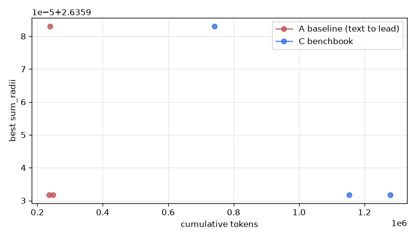

# benchbook benchmark report

| configuration | runs | evaluations | duplicate ratio | lost results | lead context max (tokens) | tokens total | API cost (USD) | final best | best per 1k tokens | lead report tokens (estimated) | delivered worker reports |
|---|---|---|---|---|---|---|---|---|---|---|---|
| A baseline (text to lead) | 3 | 238.3 ± 2.9 | 0.5342 ± 0.011 | 0 ± 0 | 8.351e+04 ± 2.2e+03 | 2.411e+05 ± 6.8e+03 | 2.266 ± 0.11 | 2.636 ± 3e-05 | 0.01094 ± 0.0003 | 3.113e+04 ± 3.2e+02 | 48 ± 0 |
| C benchbook | 3 | 233.3 ± 3.1 | 0.5025 ± 0.22 | 0 ± 0 | 8.591e+04 ± 6.3e+03 | 1.058e+06 ± 2.8e+05 | 4.252 ± 0.062 | 2.636 ± 3e-05 | 0.002635 ± 0.00081 | 1.375e+04 ± 3.7e+02 | 47.33 ± 1.2 |

Values are mean ± sample standard deviation over runs.

## Best-so-far vs cumulative tokens



0 of 6 runs reconcile assistant-message usage with the final total. Their steps use observed API usage checkpoints and the best evaluation completed by each checkpoint. Other runs contribute only their measured endpoint.

## Metric definitions

- duplicate ratio: evaluations whose (config, code) was evaluated at least twice / all evaluations
- lost results: evaluations that ran but appear neither in the lead's final report nor in a
  persistent record (ledger for C, result files for B). Real runs match individual receipt IDs,
  status and evaluation data.
- lead context max: largest prompt the lead saw (dry: simulated; real: max input+cache tokens of
  a top-level assistant turn)

- lead report tokens: token estimate of Agent/Task result payloads in the lead stream,
  once per successful tool result. Compare delivered report counts with workers × rounds.

## Conditions

```json
{
  "model": "claude-sonnet-5-5",
  "max_budget_usd": 5.0,
  "execute": true,
  "rebuilt_from": [
    "h5-sweep-16-30/workers-16/A-1",
    "h5-sweep-16-30/workers-16/A-2",
    "h5-sweep-16-30/workers-16/A-3",
    "h5-sweep-16-30/workers-16/C-1",
    "h5-runs/16-C-1-try1/C-1:C-2",
    "h5-runs/16-C-2-try1/C-1:C-3",
    "h5-runs/16-C-2-try2/C-1:C-4",
    "h5-runs/16-C-3-try1/C-1:C-5",
    "h5-runs/16-C-3-try2/C-1:C-6"
  ],
  "failed": [
    {
      "dir": "h5-sweep-16-30/workers-16/C-1",
      "error": "Claude did not finish successfully (success)"
    },
    {
      "dir": "h5-runs/16-C-2-try1/C-1",
      "error": "Claude did not finish successfully (success)"
    },
    {
      "dir": "h5-runs/16-C-3-try1/C-1",
      "error": "Claude did not finish successfully (success)"
    }
  ]
}
```
