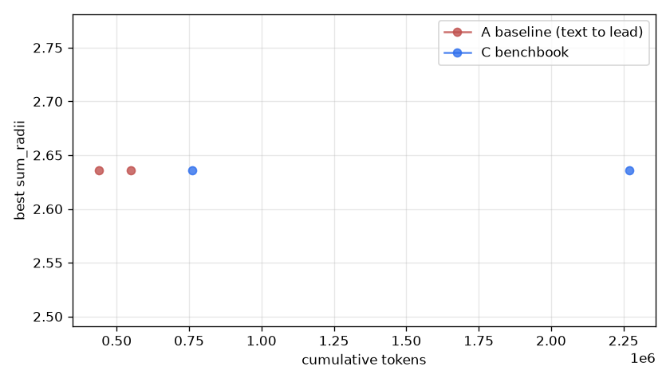

# benchbook benchmark report

| configuration | runs | evaluations | duplicate ratio | lost results | lead context max (tokens) | tokens total | API cost (USD) | final best | best per 1k tokens | lead report tokens (estimated) | delivered worker reports |
|---|---|---|---|---|---|---|---|---|---|---|---|
| A baseline (text to lead) | 2 | 437 ± 9.9 | 0.7533 ± 0.04 | 0 ± 0 | 1.508e+05 ± 1.2e+04 | 4.943e+05 ± 7.9e+04 | 4.055 ± 0.061 | 2.636 ± 0 | 0.005402 ± 0.00086 | 5.911e+04 ± 4.4e+03 | 87.5 ± 2.1 |
| C benchbook | 2 | 279.5 ± 2.1e+02 | 0.4405 ± 0.19 | 0 ± 0 | 9.225e+04 ± 5.4e+04 | 1.515e+06 ± 1.1e+06 | 2.306 ± 0.56 | 2.636 ± 0 | 0.002315 ± 0.0016 | 1.512e+04 ± 1e+04 | 59 ± 44 |

Values are mean ± sample standard deviation over runs.

## Best-so-far vs cumulative tokens



0 of 4 runs reconcile assistant-message usage with the final total. Their steps use observed API usage checkpoints and the best evaluation completed by each checkpoint. Other runs contribute only their measured endpoint.

## Metric definitions

- duplicate ratio: evaluations whose (config, code) was evaluated at least twice / all evaluations
- lost results: evaluations that ran but appear neither in the lead's final report nor in a
  persistent record (ledger for C, result files for B). Real runs match individual receipt IDs,
  status and evaluation data.
- lead context max: largest prompt the lead saw (dry: simulated; real: max input+cache tokens of
  a top-level assistant turn)

- lead report tokens: token estimate of Agent/Task result payloads in the lead stream,
  once per successful tool result. Compare delivered report counts with workers × rounds.

## Conditions

```json
{
  "model": "claude-sonnet-5-5",
  "max_budget_usd": 5.0,
  "execute": true,
  "rebuilt_from": [
    "h5-runs/30-A-1-try1/A-1:A-1",
    "h5-runs/30-A-2-try1/A-1:A-2",
    "h5-runs/30-A-2-try2/A-1:A-3",
    "h5-runs/30-C-1-try1/C-1:C-1",
    "h5-runs/30-C-2-try1/C-1:C-2"
  ],
  "failed": [
    {
      "dir": "h5-runs/30-A-2-try1/A-1",
      "error": "Claude did not finish successfully (success)"
    }
  ]
}
```
