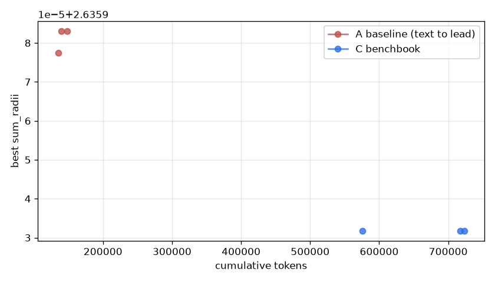

# benchbook benchmark report

| configuration | runs | evaluations | duplicate ratio | lost results | lead context max (tokens) | tokens total | API cost (USD) | final best | best per 1k tokens | lead report tokens (estimated) | delivered worker reports |
|---|---|---|---|---|---|---|---|---|---|---|---|
| A baseline (text to lead) | 3 | 124 ± 6.1 | 0.3556 ± 0.062 | 0.3333 ± 0.58 | 4.716e+04 ± 2.6e+03 | 1.412e+05 ± 6.7e+03 | 1.133 ± 0.043 | 2.636 ± 3.3e-06 | 0.0187 ± 0.00088 | 1.538e+04 ± 1.1e+03 | 24.67 ± 1.2 |
| C benchbook | 3 | 118.3 ± 5.8 | 0.3729 ± 0.077 | 0 ± 0 | 5.517e+04 ± 4.1e+02 | 6.72e+05 ± 8.3e+04 | 2.24 ± 0.14 | 2.636 ± 0 | 0.003966 ± 0.00053 | 6862 ± 1.5e+02 | 24 ± 0 |

Values are mean ± sample standard deviation over runs.

## Best-so-far vs cumulative tokens



0 of 6 runs reconcile assistant-message usage with the final total. Their steps use observed API usage checkpoints and the best evaluation completed by each checkpoint. Other runs contribute only their measured endpoint.

## Metric definitions

- duplicate ratio: evaluations whose (config, code) was evaluated at least twice / all evaluations
- lost results: evaluations that ran but appear neither in the lead's final report nor in a
  persistent record (ledger for C, result files for B). Real runs match individual receipt IDs,
  status and evaluation data.
- lead context max: largest prompt the lead saw (dry: simulated; real: max input+cache tokens of
  a top-level assistant turn)

- lead report tokens: token estimate of Agent/Task result payloads in the lead stream,
  once per successful tool result. Compare delivered report counts with workers × rounds.

## Conditions

```json
{
  "model": "claude-sonnet-5-5",
  "max_budget_usd": 5.0,
  "execute": true,
  "rebuilt_from": [
    "h5-sweep/workers-8/A-1",
    "h5-sweep/workers-8/A-2",
    "h5-sweep/workers-8/A-3",
    "h5-sweep/workers-8/C-1",
    "h5-sweep/workers-8/C-2",
    "h5-sweep/workers-8/C-3",
    "h5-sweep-c8r/C-1:C-4"
  ],
  "failed": [
    {
      "dir": "h5-sweep/workers-8/C-3",
      "error": "Claude did not finish successfully (success)"
    }
  ]
}
```
